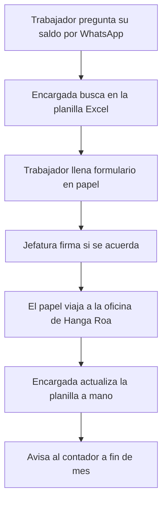
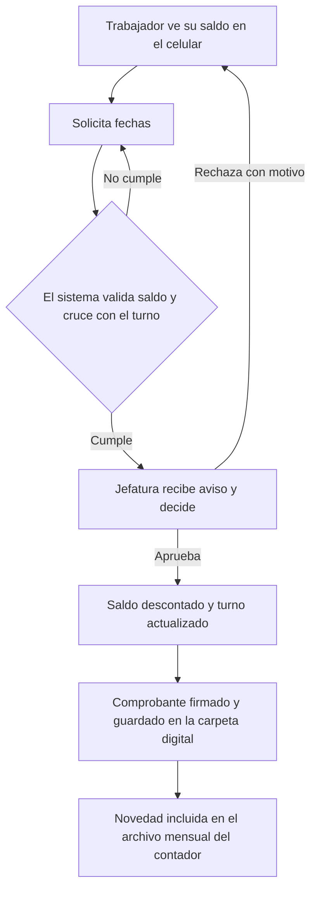
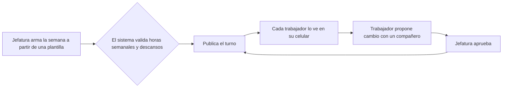

# 02. Procesos actuales y futuros

Cada paso se clasifica en una de tres categorías:

- **A (automatizable):** reglas claras, repetitivo, datos estructurados.
- **IA (asistible por IA):** redactar, resumir o responder, siempre con revisión humana.
- **H (humano):** requiere juicio, empatía o tiene efectos legales sobre una persona.

## 1. Solicitud de vacaciones

### Actual

Problemas: el saldo depende de una planilla manual, el papel de Santiago se escanea y se manda por WhatsApp, y nadie revisa si el local queda sin cajeros esa semana.

### Futuro

| Paso | Tipo | Comentario |
|---|---|---|
| Consultar saldo | A | Se calcula desde la fecha de ingreso y los días tomados |
| Validar saldo y cruces | A | Regla: no dejar un turno bajo la dotación mínima |
| Aprobar o rechazar | H | La jefatura decide; el sistema solo informa |
| Descontar y registrar | A | |
| Informar al contador | A | Archivo mensual de novedades |

## 2. Turnos de los minimarkets

**Actual:** el jefe de local arma la semana en una hoja, la pega en la pared y manda la foto al grupo. Los cambios se acuerdan por WhatsApp.

**Futuro:**

| Paso | Tipo | Comentario |
|---|---|---|
| Armar el turno | H | Con apoyo de plantillas y alertas |
| Validar horas y descansos | A | Alerta si alguien supera la jornada pactada |
| Publicar y notificar | A | |
| Aprobar cambios | H | Queda registro de quién aprobó |

## 3. Documentos y vencimientos

**Actual:** carpetas físicas en Hanga Roa. Los vencimientos se recuerdan de memoria.

**Futuro:** cada trabajador tiene una carpeta digital. El sistema avisa a los 30, 15 y 5 días antes del vencimiento de contratos a plazo fijo, licencias de conducir y otros documentos con fecha.

| Paso | Tipo |
|---|---|
| Subir y clasificar documento | A, con revisión de la encargada |
| Alertar vencimientos | A |
| Decidir si se renueva un contrato | H |
| Redactar borrador de anexo | IA en fase 2, con revisión humana |

## 4. Certificados

**Actual:** se piden a la encargada, que los redacta en Word, los imprime, firma y entrega. En Santiago se escanean.

**Futuro:** el trabajador descarga su certificado de antigüedad en PDF con un código de verificación. La encargada no interviene.

Tipo: **A**. Es el caso más claro de trabajo que no debería hacer una persona.

## 5. Ingreso y salida de trabajadores

**Futuro:** una lista de tareas por cargo (contrato, entrega de uniforme, inducción de seguridad, alta en la mutual, creación de cuenta). Cada tarea tiene responsable y fecha.

| Paso | Tipo |
|---|---|
| Generar la lista de tareas | A |
| Entrevista, inducción, bienvenida | H |
| Decisión de desvincular | H, siempre |

## 6. Cierre de mes con el contador

**Actual:** la encargada junta libros de asistencia, permisos y licencias de las 4 sedes y arma un resumen.

**Futuro:** el sistema genera un archivo con las novedades del mes (vacaciones, permisos, licencias informadas, ingresos y salidas). La asistencia legal sigue en su registro oficial (ver [ADR-0005](adr/0005-asistencia-fuera-del-mvp.md)).

## 7. Preguntas frecuentes (fase 2)

Un asistente responde preguntas sobre el reglamento interno y los beneficios, citando el artículo de donde sacó la respuesta. Si no encuentra la respuesta o el tema es sensible (acoso, despido, salud), deriva a la encargada.

Tipo: **IA**, con límites estrictos descritos en la [arquitectura](05-arquitectura.md).

## Resumen: qué cambia para cada persona

| Persona | Antes | Después |
|---|---|---|
| Trabajador | Pregunta y espera | Se atiende solo desde el celular |
| Jefatura | Papeles y WhatsApp | Aprueba con un toque y ve su dotación |
| Encargada de personas | Mesa de ayuda | Supervisa excepciones y atiende personas |
| Gerencia | Pide informes | Abre un panel |
| Contador | Recibe datos tarde y desordenados | Recibe un archivo estándar |

## Por qué lo hicimos así

- **Las decisiones sobre personas quedan en manos de personas.** Es una exigencia legal y es lo que hace que los trabajadores confíen en la herramienta.
- **Se automatiza lo aburrido primero.** Certificados y saldos son de bajo riesgo y alto volumen.
- **El proceso futuro se dibuja antes de programar.** Si el flujo no se entiende en un diagrama, tampoco se va a entender en la pantalla.
