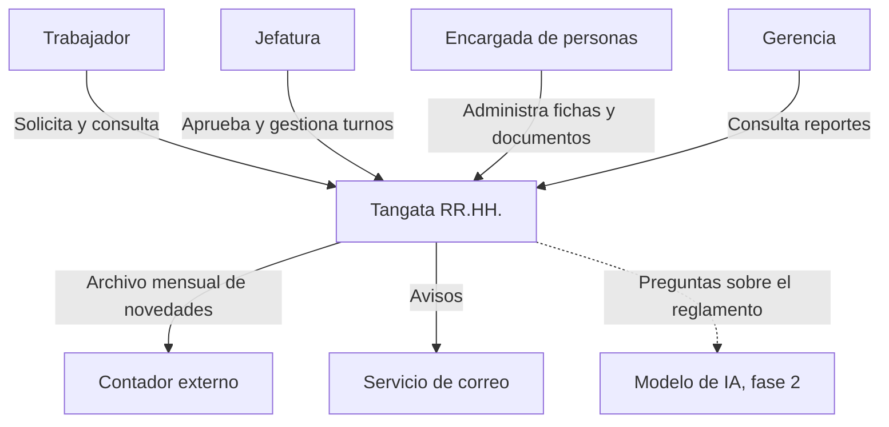
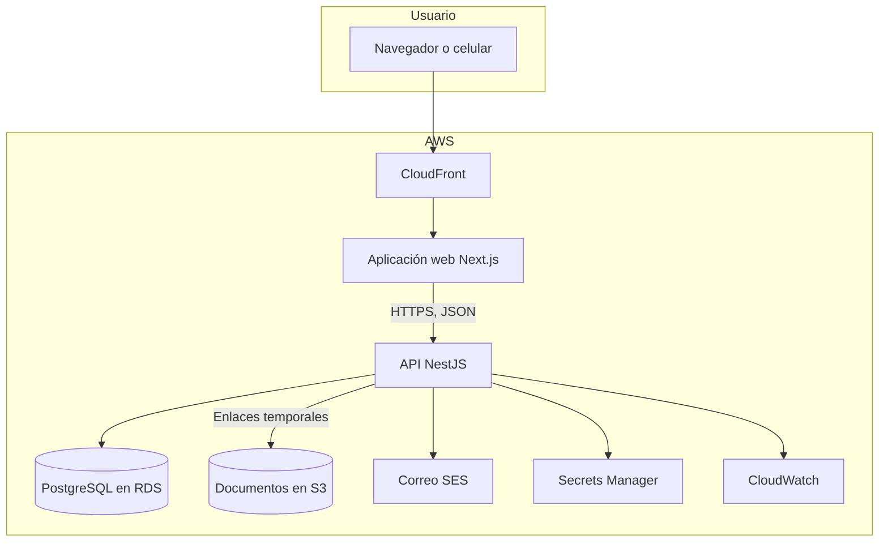
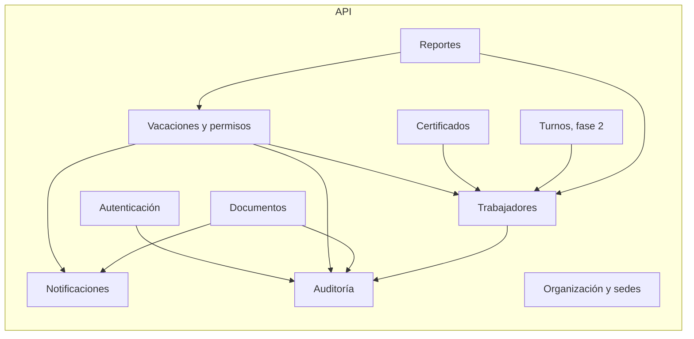
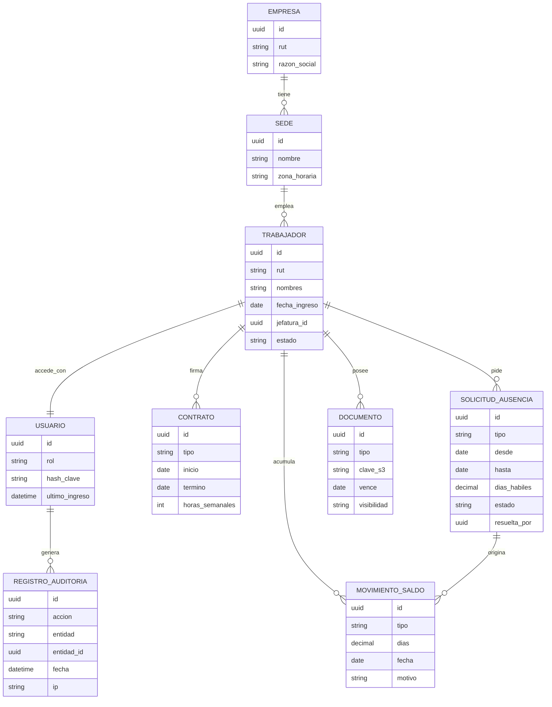
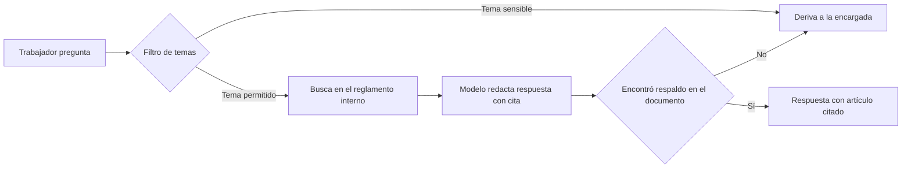

# 05. Arquitectura

Los diagramas siguen el modelo C4: primero el contexto, después los contenedores y luego los componentes.

## 1. Contexto

## 2. Contenedores

| Contenedor | Tecnología | Responsabilidad |
|---|---|---|
| Aplicación web | Next.js, React, TypeScript | Interfaz adaptable a celular, instalable como aplicación web (PWA) |
| API | NestJS, TypeScript | Reglas de negocio, permisos, auditoría |
| Base de datos | PostgreSQL con Prisma | Datos estructurados |
| Documentos | S3 privado | Archivos; nunca públicos, se entregan con enlaces que caducan |
| Correo | SES | Avisos y recuperación de contraseña |
| Secretos | Secrets Manager | Credenciales fuera del código |

## 3. Componentes de la API

Un solo servicio dividido en módulos con fronteras claras ([ADR-0003](adr/0003-monolito-modular.md)):

Regla: un módulo solo usa a otro a través de su servicio público, nunca leyendo sus tablas directamente.

## 4. Modelo de datos inicial

Decisiones del modelo:

- **El saldo de vacaciones es un libro de movimientos**, igual que una cuenta bancaria: abonos por devengo y cargos por días tomados. El saldo es la suma. Así siempre se puede explicar de dónde salió un número.
- **La tabla Empresa existe desde el inicio**, aunque haya una sola. Agregar varias empresas después es mucho más barato si cada dato ya sabe a qué empresa pertenece.
- **Cada sede guarda su zona horaria** (`Pacific/Easter` o `America/Santiago`). Ver [ADR-0004](adr/0004-zonas-horarias.md).

## 5. Seguridad

| Capa | Medida |
|---|---|
| Identidad | Ingreso con RUT y contraseña; hash Argon2; bloqueo temporal tras 5 intentos; segundo factor obligatorio para Personas, Gerencia y Administrador |
| Sesión | Token de acceso de corta duración y token de renovación en cookie segura |
| Autorización | Control por rol y por sede en cada punto de la API; denegado por defecto |
| Datos | Cifrado en tránsito (TLS) y en reposo (RDS y S3) |
| Documentos | Almacenamiento privado; descargas con enlace que caduca en minutos |
| Secretos | En Secrets Manager; nunca en el repositorio |
| Auditoría | Registro inalterable de accesos y cambios sobre datos personales |
| Entradas | Validación de todo dato recibido; consultas parametrizadas |
| Dependencias | Revisión automática de vulnerabilidades en cada cambio |
| Respaldo | Copias automáticas diarias y restauración probada |

### Clasificación de datos

| Nivel | Ejemplos | Quién accede |
|---|---|---|
| Básico | Nombre, cargo, sede | Toda la empresa |
| Personal | RUT, dirección, teléfono, fecha de nacimiento | El trabajador, su jefatura (parcial) y Personas |
| Sensible | Licencias médicas, datos de salud, afiliación sindical | Solo Personas, con registro de cada acceso |

## 6. Asistente de IA (fase 2)

| Límite | Detalle |
|---|---|
| Qué puede leer | Solo documentos oficiales publicados por Personas: reglamento interno, política de beneficios |
| Qué no puede leer | Fichas, sueldos, documentos personales, datos de otros trabajadores |
| Qué puede hacer | Responder y citar; no ejecuta acciones |
| Qué deriva siempre | Acoso, despidos, sanciones, salud, conflictos |
| Registro | Cada pregunta y respuesta queda guardada para revisión |
| Transparencia | Se identifica como asistente automático y ofrece hablar con una persona |

## 7. Despliegue

- **Infraestructura como código** con Terraform: todo el entorno se puede recrear desde el repositorio.
- **Integración y despliegue continuos** con GitHub Actions: cada cambio pasa por revisión de estilo, pruebas y análisis de dependencias antes de llegar a producción.
- **Dos entornos:** pruebas y producción.
- **Región:** se evaluará la más cercana disponible considerando latencia hacia la isla y costo.

## 8. Requisitos y cómo los cubre la arquitectura

| Requisito | Respuesta |
|---|---|
| Conexión inestable | Aplicación web liviana con caché local de las últimas vistas |
| Trabajadores sin correo | Ingreso con RUT |
| Dos husos horarios | Zona horaria por sede |
| Presupuesto pequeño | Un solo servicio, servicios administrados de tamaño mínimo |
| Crecer a más empresas | Empresa como dimensión en todos los datos |

## Por qué lo hicimos así

- **La arquitectura sale de los requisitos.** Cada decisión de la tabla anterior responde a un dato del descubrimiento.
- **Lo más simple que funcione.** Para 52 usuarios, la complejidad de operar muchos servicios cuesta más que cualquier beneficio.
- **La seguridad se diseña desde el inicio.** Agregar permisos por rol a un sistema ya construido obliga a reescribirlo.
