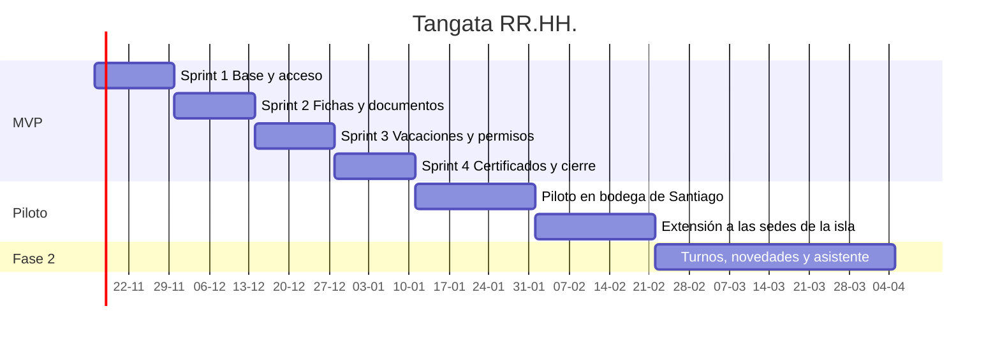

# 07. Plan del MVP

## 1. Hoja de ruta

## 2. Sprints

Cada sprint dura 2 semanas y termina con algo que se puede mostrar funcionando.

| Sprint | Objetivo | Historias | Puntos |
|---|---|---|---|
| 1 | Un usuario puede ingresar y ver solo lo que le corresponde | HU-01, HU-02, HU-03, HU-04, HU-19 | 18 |
| 2 | Las fichas y carpetas de los 52 trabajadores están cargadas | HU-05, HU-06, HU-07, HU-14, HU-15 | 19 |
| 3 | Un trabajador pide vacaciones y su jefatura las aprueba | HU-08, HU-09, HU-10, HU-11, HU-13 | 21 |
| 4 | Alertas, certificados, permisos y panel listos para el piloto | HU-12, HU-16, HU-17, HU-18, HU-20, HU-21 | 24 |
| | | **21 historias** | **82** |

El sprint 1 incluye además el andamiaje técnico: repositorio, entorno local con Docker, integración continua e infraestructura base.

## 3. Piloto

**Sede elegida: bodega de Santiago (9 personas).**

Razones:

- Es el equipo que más sufre el problema actual, por la distancia.
- Es pequeño: si algo falla, el impacto es acotado.
- Tiene buena conexión, lo que permite separar los problemas del software de los problemas de red.

Después se extiende a la isla, donde se pone a prueba el comportamiento con conexión lenta.

### Criterios para pasar del piloto al despliegue completo

| Criterio | Umbral |
|---|---|
| Trabajadores del piloto que ingresaron | 9 de 9 |
| Solicitudes de vacaciones hechas en la plataforma | 100 % |
| Errores graves abiertos | 0 |
| Saldos de vacaciones validados contra la planilla | 100 % coinciden o la diferencia está explicada |
| Satisfacción en encuesta breve | 4 de 5 o más |

## 4. Gestión del cambio

El mayor riesgo de este proyecto es que la gente no use la herramienta.

- **Encargada de personas como dueña del proyecto.** Participa en las demostraciones de cada sprint. La herramienta se presenta como su apoyo.
- **Un referente por sede** que ayuda a sus compañeros en las primeras semanas.
- **Capacitación de 20 minutos por turno**, en el local, con el celular de cada persona.
- **Guía de una página** con capturas, pegada junto al turno.
- **Período de convivencia de un mes** en que el papel sigue aceptándose.

## 5. Métricas de éxito

Las mismas del [descubrimiento](01-descubrimiento.md), medidas al mes 1, 3 y 6:

- Horas administrativas mensuales.
- Porcentaje de solicitudes hechas en la plataforma.
- Tiempo de respuesta a solicitudes.
- Vencimientos sin alerta previa.
- Usuarios activos mensuales.

## 6. Riesgos

| Riesgo | Probabilidad | Impacto | Mitigación |
|---|---|---|---|
| Baja adopción entre trabajadores | Media | Alto | Gestión del cambio; diseño pensado para celular; ingreso con RUT |
| Saldos iniciales de vacaciones incorrectos | Alta | Alto | Validación uno a uno durante el piloto; cada trabajador confirma su saldo |
| Conexión lenta en la isla | Media | Medio | Aplicación liviana y con caché; pruebas en los locales |
| Resistencia de la encargada de personas | Media | Alto | Involucrarla desde el diseño; mostrar que gana tiempo |
| Reglas legales mal interpretadas | Media | Alto | Revisión de un abogado laboral antes de producción; reglas configurables |
| Filtración de datos personales | Baja | Muy alto | Medidas de la [arquitectura](05-arquitectura.md); revisión de seguridad previa al piloto |
| Dependencia de un solo desarrollador | Alta | Medio | Código documentado, infraestructura como código, pruebas automatizadas |
| El alcance crece durante el proyecto | Alta | Medio | Lista de fuera de alcance firmada; cambios pasan por el backlog |

## 7. Forma de trabajo

- Tablero con columnas: Por hacer, En curso, En revisión, Terminado.
- Una rama por historia y un pull request por rama.
- Demostración al cierre de cada sprint.
- Retrospectiva breve: qué funcionó, qué cambiar.

## Por qué lo hicimos así

- **Piloto antes que lanzamiento general.** Equivocarse con 9 personas cuesta poco; con 52, cuesta la confianza de toda la empresa.
- **Cada sprint entrega algo visible.** El cliente ve avance real cada dos semanas y puede corregir el rumbo temprano.
- **Los riesgos se escriben antes de que ocurran.** Un riesgo con mitigación planificada es una tarea; sin ella, es una crisis.
