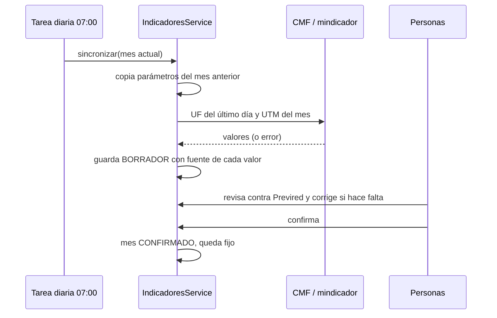

# 10. Liquidaciones e indicadores previsionales

Diseño del módulo `apps/api/src/previsional`. Público: quien mantenga o amplíe el cálculo.

> La liquidación de Tangata es **de referencia**: sirve para revisar y comparar con la del contador. Pasar a liquidación oficial exige validar meses reales contra la planilla de Previred y la revisión de un contador o abogado laboral (épica E10, HU-30).

## 1. Qué se resolvió

| Necesidad | Solución |
|---|---|
| Que las tasas estén siempre al día | Tablas con vigencia y fuente; sincronización diaria de UF y UTM; confirmación mensual por Personas |
| Que al elegir la AFP el sistema ya sepa su porcentaje | `tasas_afp` guarda la comisión con fecha de inicio; el selector muestra 10 % + comisión vigente |
| Que una liquidación pasada no cambie sola | Un mes CONFIRMADO no se vuelve a sincronizar ni a editar |
| Que se pueda auditar cada número | Cada línea de la liquidación trae la fórmula con los valores usados |

## 2. De dónde sale cada dato

| Dato | Fuente | Cómo se actualiza |
|---|---|---|
| UF | CMF (API oficial, requiere `CMF_API_KEY`); respaldo: mindicador.cl | Automático, todos los días a las 07:00 |
| UTM | Igual que la UF | Automático |
| Comisión de cada AFP | Superintendencia de Pensiones | Manual: `POST /api/previsional/afps/:id/tasas` cuando cambia (pocas veces al año) |
| Topes imponibles (90 UF y 135,2 UF en 2026) | Superintendencia de Pensiones | Se copian del mes anterior; se corrigen cuando cambian (normalmente en enero o febrero) |
| Tasa SIS | Previred / Superintendencia de Pensiones | Se copia del mes anterior y se verifica cada mes; cambia por licitación |
| Cotización del empleador Ley 21.735 | Calendario de la ley: 1 % (ago-2025), 3,5 % (ago-2026), 4,25 % (ago-2027)… | Se copia y se corrige en cada agosto |
| Ingreso mínimo | Ley de reajuste | Se corrige cuando se publica |
| Tramos de impuesto | SII, en UTM | Se copian; solo cambian por reforma legal |

**Por qué no todo es automático:** ningún organismo publica comisiones AFP, SIS o topes en una API. Leer páginas web (scraping) es frágil: un cambio de diseño en el sitio rompe el cálculo sin aviso. Se eligió que el sistema copie, avise y que una persona confirme. Un adaptador que lea la página de la Superintendencia está en el plan como mejora (ver `docs/11-plan-antigravity.md`, tarea T3), siempre como propuesta que Personas confirma.

## 3. Flujo mensual

Si una fuente falla, el valor anterior se mantiene, el log registra la advertencia y la pantalla lo informa. La aplicación nunca se cae por una fuente externa.

## 4. Fórmulas

| Concepto | Fórmula | Base legal |
|---|---|---|
| Sueldo proporcional | sueldo base × días / 30 | Código del Trabajo |
| Valor hora extra | (sueldo / 30 × 28) / (4 × jornada semanal) × 1,5 | CT art. 32 |
| Gratificación | mín(25 % de lo devengado, 4,75 × ingreso mínimo / 12 × días / 30) | CT art. 50 |
| Base AFP y salud | mín(imponible, tope AFP en UF × UF) | DL 3.500 |
| AFP | base × (10 % + comisión) | DL 3.500 art. 17 |
| Salud Fonasa | base × 7 % | |
| Salud Isapre | máx(base × 7 %, plan en UF × UF) | |
| Cesantía trabajador | 0,6 % indefinido; 0 % plazo fijo u obra | Ley 19.728 |
| Base tributable | imponible − AFP − 7 % legal de salud − cesantía | LIR art. 42 |
| Impuesto único | base × factor del tramo − rebaja del tramo × UTM | LIR art. 43 |
| Aportes del empleador | SIS, reforma, cesantía (2,4 % o 3 %) y accidentes sobre sus bases | |

Lo que un plan de Isapre excede del 7 % se descuenta al trabajador pero **no** rebaja la base tributable.

## 5. Casos de prueba calculados a mano

Parámetros de prueba: UF $40.000, UTM $70.000, ingreso mínimo $553.553, topes 90 y 135,2 UF.

**Caso 1: sueldo $800.000, AFP Modelo (0,58 %), Fonasa, indefinido**

| Línea | Cálculo | Monto |
|---|---|---|
| Gratificación | 25 % × 800.000 = 200.000 < tope 219.115 | 200.000 |
| Imponible | 800.000 + 200.000 | 1.000.000 |
| AFP | 1.000.000 × 10,58 % | 105.800 |
| Salud | 1.000.000 × 7 % | 70.000 |
| Cesantía | 1.000.000 × 0,6 % | 6.000 |
| Base tributable | 1.000.000 − 105.800 − 70.000 − 6.000 = 818.200 (11,69 UTM) | exenta |
| Líquido | 1.000.000 − 181.800 | **818.200** |

**Caso 2: sueldo $4.000.000, AFP Habitat (1,27 %), Isapre 4 UF**

| Línea | Cálculo | Monto |
|---|---|---|
| Gratificación | tope: 4,75 × 553.553 / 12 | 219.115 |
| Imponible | | 4.219.115 |
| Base AFP | tope 90 × 40.000 | 3.600.000 |
| AFP | 3.600.000 × 11,27 % | 405.720 |
| Salud | máx(252.000; 160.000) | 252.000 |
| Cesantía | 4.219.115 × 0,6 % | 25.315 |
| Base tributable | 3.536.080 = 50,52 UTM → tramo 13,5 %, rebaja 4,49 UTM | |
| Impuesto | 3.536.080 × 13,5 % − 4,49 × 70.000 | 163.071 |
| Líquido | | **3.373.009** |

Todos los casos están en `apps/api/src/previsional/liquidacion/calculo.spec.ts`.

## 6. Cómo ampliar

- **Licencias médicas:** agregar días de licencia a `DatosTrabajador`; los días de licencia no se pagan como sueldo y la cotización la cubre el subsidio. Requiere la renta imponible del mes anterior (campo nuevo de la reforma).
- **Asignación familiar:** tramos por ingreso en una tabla con vigencia, igual que `tasas_afp`.
- **Archivo Previred:** generar el formato de carga masiva a partir de `Liquidacion`; validar contra una planilla real antes de usarlo.
- **Comparación con el contador (HU-30):** importar su libro de remuneraciones en CSV y mostrar diferencias por línea.
